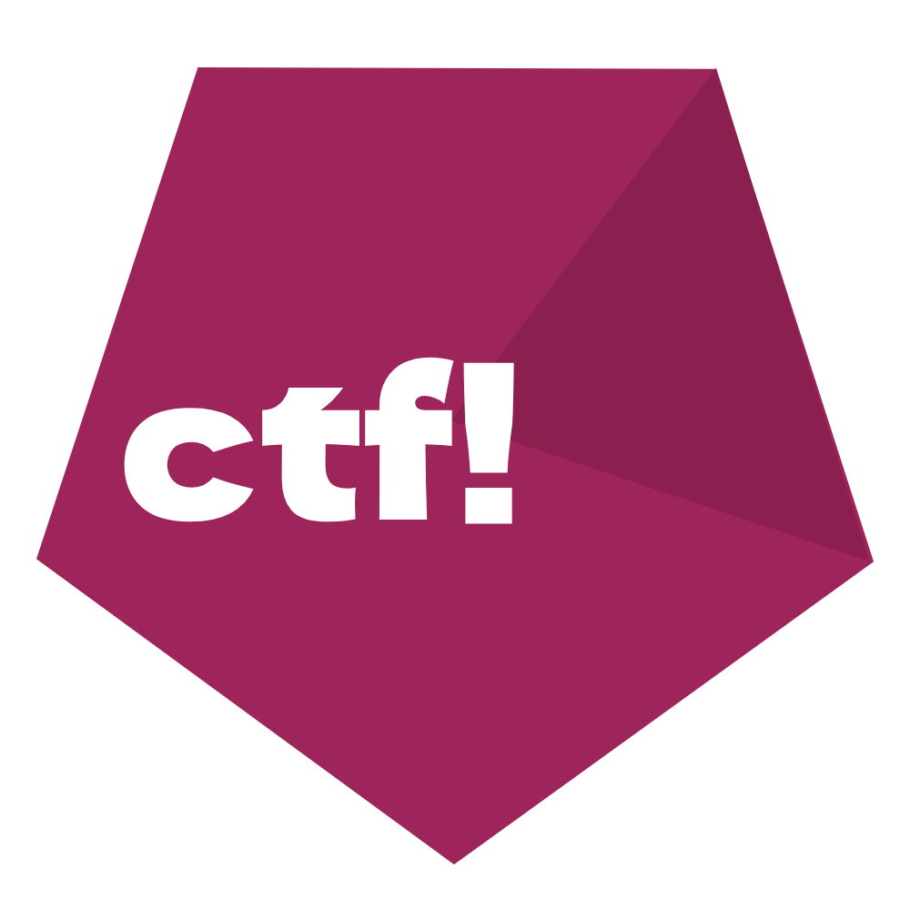

# ctf! - Compile That File!



An experimental programming language and compiler written in C.

The compiler is created specifically for the TJ (Triple J) programming language.

## The main features of the programming language TJ:
```
* precise division of code into sections.
* the ability to embed code from other low-level programming languages ​​into the main code.
* the ability to reduce the level of abstraction to a minimum.
```
## Example TJ syntax: (subject to change)

```
@use@:
	...

@func@:
	fnc: int _name():{};

@data@:
	inz: int a;
	inz: real b;
	inz: str c;

@main@:

	_fwrite("%d\t%e\t%s\t\n" , $a , $b , $c);

@end@;

```

## One more example:

```

@func@:

    fnc: int _sum(int $a , int $b):{
        return: ($a + $b);
    };

@data@:

    inz: int $a := 0;
    inz: int $b := 0;

@main@:

    _fwrite("%d" , _sum($a , $b));

    

@end@;


```


## Compiling : 
`` ctf -L2 -w .../just_test.tj -o helloworld -r  ``

## Current project state:

The project is still in development!
And will likely remain so for a very long time.
**I'm writing this on October 18, 2026, at 11:57 PM.**
